# 構成図の記法と例

[図の選択指針](DRAWING.md#ダイアグラムの選び方)で形式を選んだ後に、該当する節を読む。
以下は説明用の仮想構成であり、実在するサービスの構成を示すものではない。

## Mermaid architecture

クラウドのサービス、配置グループ、接続を示すときに使う。
フェンス名は `mermaid`、その中の図種が `architecture-beta` である。
`architecture` というフェンスや、`flowchart` の辺ラベル構文を混ぜない。

この例の囲みはバックエンドの配置グループ、矢印は API から保存先へのアクセス方向を表す。
信頼境界や時系列は表していない。

```mermaid
architecture-beta
  group backend(cloud)[Backend deployment]
  service api(logos:aws-lambda)[API] in backend
  service db(logos:postgresql)[Database] in backend
  service cache(logos:redis)[Cache] in backend
  api:B --> T:db
  api:R --> L:cache
```



`group` と `service` を宣言してから接続を書く。
`L`、`R`、`T`、`B` はそれぞれ左、右、上、下の接続位置を表し、`-->` は接続先側に矢印を付ける。
接続の意味が複数あるときは本文に凡例を添えるか、辺にラベルを付けられる D2 や LikeC4 を選ぶ。

組み込みアイコンは `cloud`、`database`、`disk`、`internet`、`server`。
Track は Iconify Logos も同梱しており、例の `logos:aws-lambda`、`logos:postgresql`、`logos:redis` を外部アイコンサービスへの通信なしで使える。
別のパックや任意のアイコン URL が使えるとは仮定しない。利用する名前が同梱パックにあるか確認する。
ロゴは製品の識別に使い、それだけで実装や配置先が確認済みであるとは扱わない。

配置は接続位置とグループから決まる。順序や位置を固定する描画ツールではない。
細かな構文は [Mermaid architecture](https://mermaid.js.org/syntax/architecture.html) を参照し、Track 同梱版で検証する。

## LikeC4 のモデルと複数ビュー

同じシステムの概要と内部構造を繰り返し説明する場合は、`likec4` フェンスに一つのモデルと複数のビューを書く。
`specification` で要素の種類を定義し、`model` で要素と関係を記述し、`views` で表示範囲を選ぶ。
関係の変更はモデルに一度反映し、影響するビューを確認する。

C4 の component 図は、一つのコンテナ内部のコンポーネントと責務、関連する外部要素を示す。
ここでのコンテナはアプリケーションやデータストアの単位で、Docker コンテナに限定されない。
LikeC4 の `element component` は作者が定義する種類名であり、C4 の粒度や責務を自動で保証しない。
任意の親子要素を展開した図を、一律に C4 component 図と呼ばない。

次の例は、注文システムの中に Web アプリ、API アプリ、DB を置き、API アプリの内部を二つのコンポーネントに分ける。
矢印は利用または依存の方向で、各ラベルが関係の内容を表す。

```likec4
specification {
  element person
  element system
  element container
  element component
}
model {
  customer = person '利用者'
  shop = system '注文システム' {
    web = container 'Web アプリ'
    api = container 'API アプリ' {
      orders = component '注文受付' {
        description '注文を検証して保存する'
      }
      inventory = component '在庫照会' {
        description '注文に必要な在庫を照会する'
      }
    }
    db = container '注文 DB' {
      style { shape cylinder }
    }
  }
  customer -> shop.web '注文する'
  shop.web -> shop.api.orders 'HTTPS'
  shop.api.orders -> shop.api.inventory '在庫を確認'
  shop.api.orders -> shop.db '注文を保存'
  shop.api.inventory -> shop.db '在庫を照会'
}
views {
  view overview {
    title 'システム全体'
    include *
    autoLayout TopBottom
  }
  view containers {
    title 'コンテナ構成'
    include customer, shop.*
    autoLayout TopBottom
  }
  view api_components {
    title 'API アプリの内部コンポーネント'
    include shop.web, shop.api.*, shop.db
    autoLayout TopBottom
  }
}
```

`include *` はトップレベル、`shop.*` は直下の子、`shop.api.*` は API 内部の子を選ぶ。
概要では内部の関係が上位要素間の関係へ集約されるため、線を個別の通信経路と読み替えない。
component ビューの主対象は API アプリ内の二要素であり、Web アプリと DB はその外側の関連コンテナである。
要素名だけで責務が伝わらなければ `description` と本文で補う。

Track では図の上のボタンでビューを切り替える。
各ビューには一意な名前を付け、`title` に読者向けの表示名を書く。省略時はビュー名が表示される。
**少なくとも一つのビューを明示する。** 自動生成ビューは Track の表示対象にならない。
Copy source は選択ビューだけでなく、モデルと全ビューをコピーする。

Track の LikeC4 描画には次の制約がある。

- 一つのフェンスまたは添付ファイル内で完結する。他のフェンス、ノート、プロジェクトの定義は読み込まない。
- プロジェクト設定、手動レイアウトファイル、LikeC4 本体のアプリやエディタは読み込まない。
- Graphviz による SVG 出力なので、LikeC4 の対話ビューアと形や配置が異なる場合がある。
- 外部アイコンや画像、クリック可能なリンク、ノードから別ビューへの遷移、アニメーション、HTML ラベル、独自 CSS は表示に使えない。出典は図の外に脚注で置く。
- 上限はソース100,000文字、明示ビュー24個、各ビュー500要素。解析と描画は worker で実行し、30秒で打ち切る。上限以内でも複雑な図は時間制限に達し得る。
- 構文、参照先、ビュー未定義、上限、描画のエラーは元ソースとともに表示される。大きなモデルは範囲を絞り、分割先にも必要な定義を含める。

C4 の意味は [Component diagram](https://c4model.com/diagrams/component)、DSL は [LikeC4 Views](https://likec4.dev/dsl/views/) を参照する。
上流の機能紹介より、上記の Track の表示契約を優先する。

## D2 と TALA

独自の境界、形、関係ラベルを組み合わせる構成図に `d2` フェンスを使う。
Dagre が既定で、ELK と TALA も同梱されている。
入れ子や階層をまたぐ接続がある図では TALA を比較候補にする。
追加プラグイン、ライセンスキー、外部描画サービスは不要である。

```d2
vars: {
  d2-config: {
    layout-engine: tala
  }
}
direction: down
user: 利用者
backend: バックエンド {
  api: API
  db: 注文DB { shape: cylinder }
  api -> db: 読み書き
}
user -> backend.api: HTTPS
```

`layout-engine` を `dagre` または `elk` に替えて比較する。
TALA でも細部の編集で図全体の配置が変わる場合があるため、配置の固定や可読性の改善を保証しない。
図の分割とレイアウト比較を併用する。

各フェンスまたは `.d2` 添付は単一ソースで、他のアセットやローカルファイルを import できない。
表示されるのはルートボードのみ。リンク、画像アイコン、外部 HTML や CSS は除かれる。
通常のラベル、Markdown ラベル、形、生成されたスタイルと埋め込みフォントは利用できる。
エンジンは必要時に読み込まれ、同じページの描画は順に処理される。
`link` などの予約語はノード ID にしない。

## 添付ファイルと確認した実装

同じソースをファイルで保持する場合は `track asset import` で取り込み、返された参照を単独行の画像構文に置く。
Mermaid は `.mmd` / `.mermaid`、D2 は `.d2`、LikeC4 は `.c4` / `.likec4` を対応するフェンスと同じレンダラーで描画する。

```markdown

```

この記述は [Track main `1cdb8f7`](https://github.com/ttak0422/track/tree/1cdb8f7a9950789f7fe9dd0b4de9f91d0ef5b07c) の以下を確認したもの。
利用中の版で差がある場合は、その版の実装と help を確認する。

- `web/package.json` / `web/package-lock.json`: Mermaid 11.16.1、`@iconify-json/logos` 1.2.15、`@d2lang/d2` 0.1.34 (D2 0.9)、`@likec4/language-server` 1.59.4。
- `web/src/components/markdown/`: `mermaidIcons.ts`、`D2Diagram.tsx`、`d2Svg.ts`、`likec4Model.ts`、`likec4Types.ts`、`likec4Engine.ts`、`LikeC4Diagram.tsx`、`safeDiagramSvg.ts`、`urls.ts`。
- `docs/help/note/1785024005000.md` (Diagrams): 使える図種、操作、添付、制約。

[図の検証](DRAWING.md#図の検証)に従い、構文検査と実際の描画、意味の確認を区別する。
