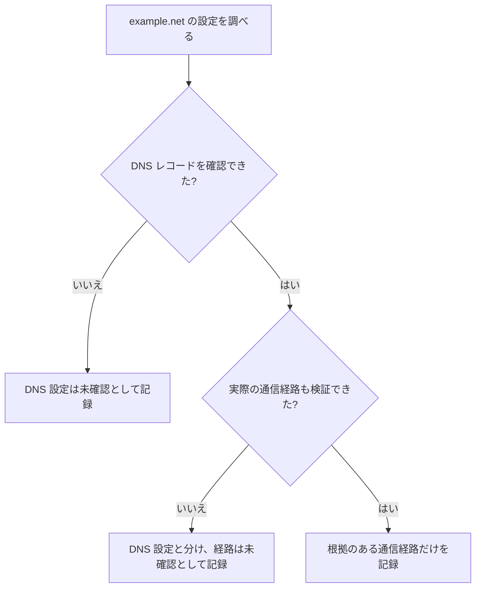
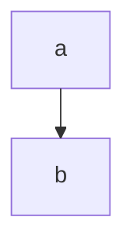

# 描画フェンス

図表や実行可能なフェンスを使うときに参照する。通常のノート作成では不要。

## フェンスの選択

ノート本文は散文だけではない。内容が構造的な場合は、段落や ASCII の図よりも、対応する構文を使う。

| 構文 | フェンス / 構文 | 用途 |
| --- | --- | --- |
| ダイアグラム | ` ```mermaid `, ` ```likec4 `, ` ```d2 `, ` ```dot ` / ` ```graphviz ` | 構成、フロー、シーケンス、ER、状態機械。問いに合う種類と記述形式を選ぶ（下記参照） |
| draw.io | ` ```drawio ` | diagrams.net で保存した XML を描画。最初のページを表示 |
| マインドマップ | ` ```mindmap ` | 意味を保てる階層関係そのものを整理する。密な図の代替にはしない |
| チャート | ` ```viewspec ` | ボールト内の JSONL データをプロット |
| クエリ | ` ```track-query ` | ノート上のライブなテーブル/ボード/ギャラリー/カレンダー |
| タスクボード | 空の ` ```taskboard ` | ノート自身のタスクをかんばん表示 |
| ダッシュボード | ` ```dashboard ` | 最近/ピン留めのウィジェット |
| Babel | ` ```lua :name hello :results output ` | 実行可能なコードブロック。結果はサイドカーに保持され、noweb で合成、ファイルへタングル可能 |
| 埋め込み | 単独行の `` | YouTube、Google マップ、ツイート、PDF、`assets/` メディア |

完全な構文は track リポジトリのヘルプボールト（`docs/help/note/`。Diagrams、Charts、Embeds などのノート）にあり、ヘルプサイトにも公開されている。

空の ` ```mindmap ` フェンスはノート自身の見出しツリーを描画する。`viewspec` の `data.source` はボールトの `data/` ディレクトリを基準に解決する。

## ダイアグラムの選び方

図を描く前に、図で答える問いを定めます。図の種類と記述形式は別の選択です。

| 図で答える問い | 第一候補 | 選ぶ理由 |
| --- | --- | --- |
| 処理の順序、条件分岐、時間順のメッセージは何か | Mermaid の `flowchart` / `sequenceDiagram` | 手順とやり取りを直接記述できる。ER や状態遷移にも対応する図種を使う |
| クラウドのサービスをどの配置グループにまとめ、どう接続するか | Mermaid の `architecture-beta` | `group`、`service`、接続ポート、同梱のロゴで配置を示せる |
| 同じシステムを全体、コンテナ、内部コンポーネントなど複数の粒度で読みたいか | LikeC4 | 要素と関係を一つのモデルに定義し、複数のビューで切り替えて読む |
| 独自の境界や関係ラベルを持つ構成を柔軟に描きたいか | D2 | 入れ子と形を組み合わせ、Dagre、ELK、TALA を比較できる |
| DOT のグラフや既存の DOT ソースを扱うか | Graphviz (`dot`) | グラフの属性とレイアウトを直接記述できる |

Mermaid architecture、LikeC4、D2 の記法と実行制約は [構成図の例](ARCHITECTURE.md) を参照する。
構成図や C4 component 図を描くために手作業の SVG や HTML を作る必要はない。
図の意味を対応フェンスで表し、独自の操作や計算が必要な場合に HTML ツールを選ぶ。

レイアウトより先に、図の対象範囲と抽象度をそろえる。
境界が囲むものはシステム、配置、信頼、管理、または単なる図の範囲のどれかを明記する。
辺の意味も通信、依存、データの流れ、DNS 設定、管理関係などから特定する。
ラベルを書けない図種では、図の直前に凡例を置く。
確認済みの事実と未確認の部分を区別し、囲みや線から根拠のない責務や経路を推測させない。
図に用いた事実の出典は本文やキャプションの脚注に置く。描画成功は事実の検証を意味しない。

静的な構成を Mermaid `flowchart` で描いてもよいが、無向の辺や関係ラベルを使い、矢印には向きの意味を添える。
意味を保ったうえで、次の見た目とレイアウトを整える。

同じドメイン名に Cloudflare Workers と iCloud+ が関係すると分かっていても、それだけでは両者が直列の通信経路だとは言えません。DNS レコードや管理主体が不明なら、関係を「同一ドメインに関するもの」と明記し、DNS 設定・管理境界・実際の通信経路は未確認として残します。実構成や経路を補ってはいけません。

次の例は、確認できている前提を「同じドメイン名が両サービスに関係する」だけに限定しています。構成図ではサービスを並列に置き、線を通信経路ではない関係として明記します。

```d2
direction: down

scope: "確認できる範囲: 同一ドメインに関する申告\n（管理境界・通信経路ではない）" {
  domain: "example.net\n同一ドメイン: 確認済み"
  workers: "Cloudflare Workers\n設定詳細: 未確認"
  icloud: "iCloud+\n設定詳細: 未確認"

  domain -- workers: "同一ドメインとの関係"
  domain -- icloud: "同一ドメインとの関係"
}

unknown: "未確認: DNS レコード / 管理主体 / 実際の通信・メール経路"
```

同じ題材でも、設定をどう調べるかという順序と分岐を示すならフローチャートです。これは実構成を表す図ではありません。



`mindmap` は、元の情報の階層関係を保ったまま整理でき、階層そのものが問いへの答えになる場合に限ります。構成、通信、因果など異なる関係を単なる親子関係へ置き換えたり、密な図の避難先にしたりしないでください。

## ダイアグラムの見た目とレイアウト

色は原則として指定せず、区別には形、ラベル、境界を使う。
Mermaid と D2 は Track のテーマに合わせて描画されるが、ソース側のテーマ指定が優先される場合がある。
`style` や `classDef` の塗り、`themeVariables`、D2 のテーマ ID を通常の図には書かない。
Graphviz と LikeC4 の SVG はダークテーマ時にフィルターで調整されるため、独自色がそのまま再現されるとは限らない。
ロゴの色だけに意味を持たせず、ライトとダークの両方でラベルと境界を確認する。
色そのものが内容の場合は前景と背景を組で指定し、両テーマで確認する。

図は本文カラムに収まる幅から表示される。ズーム、ドラッグ、Reset、ポップアップを使えるが、初期表示でも要点を読める大きさにする。
`flowchart` は `TB` を出発点にし、`LR` は短い流れで検討する。
幅が参加者数に左右されるシーケンス図は対象を絞る。
LikeC4 は概要と詳細をビューに分け、詳細をどのビューで読むか本文に案内する。

密なグラフでは、意味を保ったままレイアウトを比較する。
Mermaid の `flowchart` では次のように ELK を選べる。これは `architecture-beta` に流用する設定ではない。

````markdown

````

この `---` はフェンスの中にある**図自身の** frontmatter です。ノート本文の frontmatter ではありません（そちらは書きません。メタデータはサイドカーです）。

D2 のレイアウト比較は [D2 と TALA](ARCHITECTURE.md#d2-と-tala) を参照する。
それでも読めなければ、問いに答える関係ごとに図やビューを分ける。
`mindmap` へ替えるのは、階層関係そのものが問いに合い、元の意味を保てる場合に限る。

## 図の検証

対応フェンスの例は利用中の Track と同じ版で確かめる。
Track のソースがある場合は、`web/package-lock.json` のパーサーと描画実装を基準にする。
別版のオンラインエディタや D2 CLI での成功だけでは、Track での成功を保証できない。

- Mermaid は実パーサーで構文を検査し、Track 上で配置、ロゴ、ラベルを確認する。
- LikeC4 は名前解決と明示した全ビューの描画を確認する。概要と詳細で対象が意図どおりに展開されるか、ビューを切り替えて確かめる。
- D2 はソース内で選んだエンジンでコンパイルと SVG 描画を行う。TALA を使う場合は TALA 自体で検証する。
- 狭い本文カラムとライト、ダークの両テーマで読めるかを見る。エラーが出たら元ソースを修正し、巨大なモデルは自己完結する図に分割する。

`track export` は保存した Markdown を確認する操作であり、図の描画検証ではない。
保存、構文検査、描画、内容の裏付けを分けて記録し、未実行の確認は明記する。
チャートの `viewspec` 検証は次の節に従う。

## チャート

viewspec に書くのは**何を意味するか**であって、どう見えるかではない。色・大きさ・目盛りはテーマとレンダラーが決める。スキーマが未知フィールドを拒否するので書けるものは元から絞られているが、テーマの外へ出られる穴が1つある。`color.colors` は生の CSS 色を受け取るので、色そのものが意味を持つとき（買いと売り、合格と不合格）だけ使う。

`title` には**発見そのもの**を一文で書く。「AAPL close」ではなく「決算後に前四半期の高値を割り込んだ」である。`Jan` や `Chrome` は自分が何者か名乗るが、`26` や `0.42` は名乗らない。その名乗りを与えるのが見出しであり、測った対象と単位は `encoding.x.title` と `encoding.y[].title` が担う。自前のキャプションを持つ図では省いてよい。省いても壊れず、軸ラベルが代わりを務める。

埋め込む前に、使い捨てのコピーを通す。

```sh
track render --spec /tmp/spec.json --out /tmp/spec.html
```

成功すると `{"path": …, "records": N}` を返す。`N` が想定した件数かを見る。そのうえで確かめる。

- `data.kind` が正準の5種（`event` / `price` / `metric` / `entity` / `annotation`）のどれかである。
- `encoding` が参照する `field` がすべて実在する。kind の定義済みフィールドか、レコードが実際に持つ追加フィールドである。
- 種類に必要なチャネルが揃っている。`treemap` は `size`、`rect` は量的な `color`、`candlestick` は OHLC を含意する。
- `title` が列名ではなく結論になっている。
- 大きなデータを `data.records` に貼っていない。ファイルは `data.source` で指す。
- 合計行と内訳行が同じ系列に混ざっていない。積み上げや色分けで二重に数えられる。
