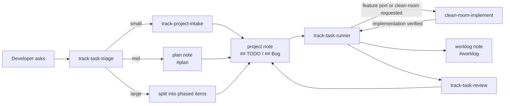

# Task Plugin

`task` は track vault 上のタスクのライフサイクルを担う。入ってきた作業をサイズで振り分け、プロジェクトノートのチェックリストに記録し、そのチェックリストを消化して日付つき worklog へ移す。CLI 操作の真実の情報源は `track` であり、このプラグインはその手順だけを定める。

`note` プラグインは共有記録のプリミティブ（ノート作成・検索・Markdown 方言・レポート・ Explainer・watch）を持ち、`task` はその上の TODO / Bug の運用を持つ。フルループで使う場合は両方を入れる。

Timeline は別経路で、明示依頼があるときだけ既存の vault とプロジェクトを確認し、節目を記録する。区間レポートには対応 CLI が必要で、タイマーは起動しない。`intervals --help` に `-evidence-version` が出る版では、タスクが進行中でも確認済みの成果・阻害要因・次の作業を記録して区間レポートに使える。未対応版では従来の状態遷移を使う。

## Skills

| Skill | Purpose |
| ----- | ------- |
| [clean-room-implement](skills/clean-room-implement/SKILL.md) | 既存実装を参考にした機能移植・再実装で原則利用する。参照元固有の名称や内部構造を仕様から除き、別の担当が実装・検証する。互換性に必要な名称は保持する。 |
| [track-task-triage](skills/track-task-triage/SKILL.md) | 依頼や既存チェックリストを S/M/L に振り分け、曖昧なものは書く前に明確化し、サイズ別の経路（直接・プランノート付き・分割）へ回す。 |
| [track-project-intake](skills/track-project-intake/SKILL.md) | 入ってきたバグ/TODO をプロジェクトノートの `## Bug` / `## TODO` に記録し、合意が必要な場合だけリンクするプランノートを下書きする。 |
| [track-task-runner](skills/track-task-runner/SKILL.md) | プロジェクトノートのチェックリストを自律的に消化し、完了項目をコミットとともに日付つき worklog ノートへ移す。 |
| [track-task-review](skills/track-task-review/SKILL.md) | 対応完了後を整理する。取り残された完了項目を worklog へ移し、期限切れと WAITING を見直し、終わった議論を archive へ畳み、優先度を付け直す。 |
| [track-timeline](skills/track-timeline/SKILL.md) | 依頼された作業の進捗を Track Timeline に記録し、Komado 用のプロジェクト ID を返す。 |
| [track-timeline-interval-reports](skills/track-timeline-interval-reports/SKILL.md) | 明示依頼時のみ、作業中に閉じた15分区間のレポートを記録する。対応する Track CLI が必要。 |

## The loop



## Conventions

A flat TODO note holds nothing but task lines under one list. It is mechanically managed:
change states and dates only through the CLI write path (`task set` / `cycle` / `date`,
`triage` / `intake` for adds and moves), and do not hand-edit task lines. Mark the note
with an HTML comment to that effect so the policy travels with the body without rendering.
Project backlogs otherwise use `## TODO` and `## Bug`. The [shared task conventions](references/runtime.md#task-conventions)
define state changes, permitted body edits, and phased work for the track task lifecycle skills.
A note may carry a stricter policy in an HTML comment; preserve and follow it.

実装は[共通方針](references/runtime.md#worktrees-and-parallel-execution)に従い、専用ブランチと worktree を既定とする。同じ作業を現在のブランチで対応中なら継続し、独立した項目は可能なら別エージェントで並列実行する。ノート更新は調整役が直列に行う。記録・振り分け・棚卸しだけなら worktree は不要。

## Requirements

- `track` CLI が `PATH` 上にあり、ユーザーの通常のボールトに対して解決できること。

## Layout

```text
plugins/task/
├── .claude-plugin/plugin.json
├── .codex-plugin/plugin.json
├── references/runtime.md
└── skills/
    ├── track-task-triage/SKILL.md
    ├── track-project-intake/SKILL.md
    ├── track-task-runner/SKILL.md
    ├── clean-room-implement/SKILL.md
    ├── track-task-review/SKILL.md
    ├── track-timeline/SKILL.md
    └── track-timeline-interval-reports/SKILL.md
```

各 task skill は同梱された `references/runtime.md` を読む。正本は `plugins/task/references/runtime.md` で、変更時は各コピーを更新して layout test で一致を確認する。

## Install

Install the plugin in the client you already use; neither client needs hooks
or persistent environment changes for the explicit workflow.

### Claude Code

```sh
claude plugin marketplace add ttak0422/track-lab
claude plugin install task@track-lab
```

For local plugin development instead: `claude --plugin-dir ./plugins/task`.

### Codex

```sh
codex plugin marketplace add ttak0422/track-lab
codex plugin add task@track-lab
```

For OpenCode and other `AGENTS.md`-aware agents, use the complete OpenSkills installation in
[the repository README](../../README.md#openskills). The task skills link to siblings, so install
the whole set.

## Use Timeline in a normal session

Both clients use the same existing vault and Timeline project. Replace `work-demo`
with the project ID. Name the existing vault as well when the choice is ambiguous.
Choose one of these requests; the interval request also turns on ordinary tracking.

Claude Code, using the task plugin's native commands:

```text
/task:track-timeline この調査を work-demo に記録して。成果、阻害要因、次にやることを節目で残して。
/task:track-timeline-interval-reports work-demo に記録して、閉じた15分区間も要約して。
```

Codex, using its skill mentions:

```text
$track-timeline この調査を work-demo に記録して。成果、阻害要因、次にやることを節目で残して。
$track-timeline-interval-reports work-demo に記録して、閉じた15分区間も要約して。
```

A plain-language request for the same workflow also works when the client can
load the skills. For example, while a regression investigation remains `active`,
the agent can record a verified result (duplicate rows now pass), a blocker if
present (a fixture lacks wrapped rows), and the next step (add that fixture).
When asked for intervals, it can summarize those entries at the next ordinary
milestone, with no need to wait for the task to become `done`. This evidence
requires the version 2 capability; older Track builds use status transitions.
If the agent delegates an investigation, the main conversation verifies and
records the returned findings through its own run. It does not share the run
with subagents or require Komado to be open.
